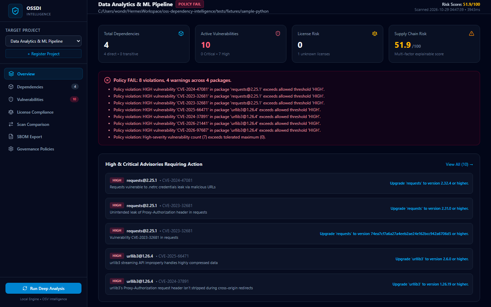
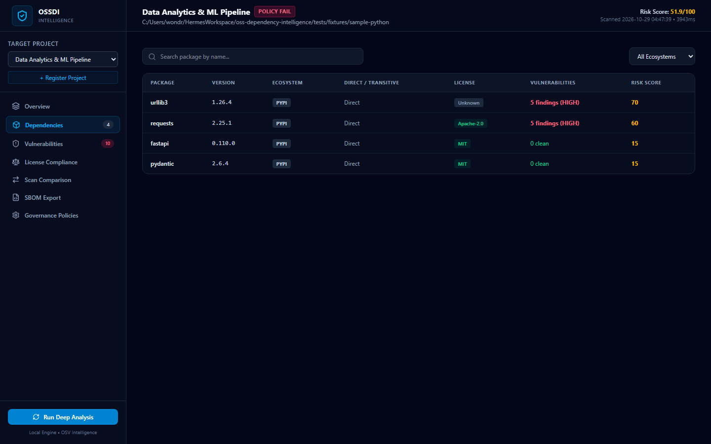
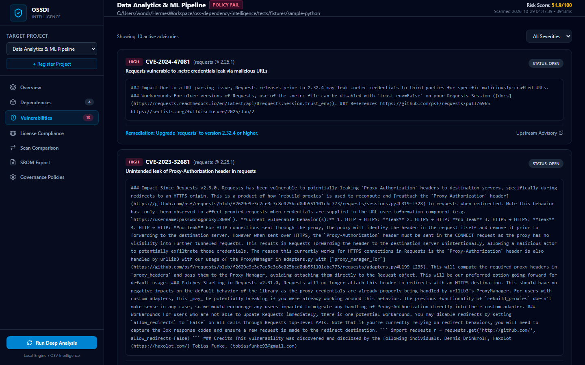
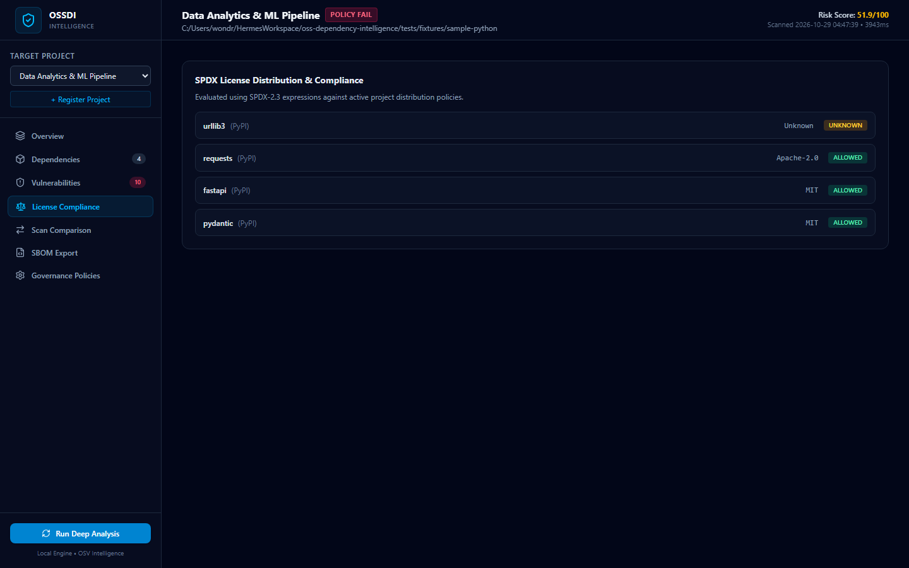
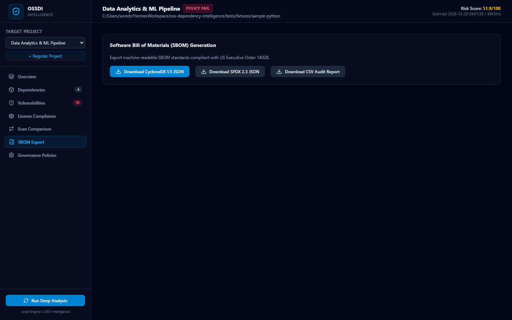
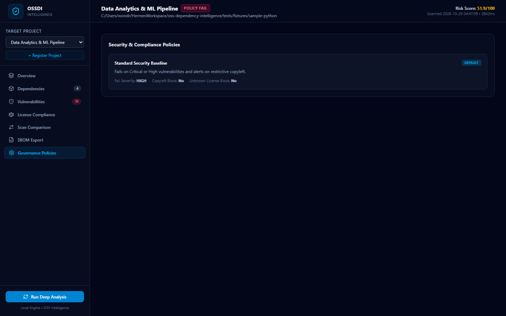

# OSS Dependency Intelligence 🛡️
### Understand Your Dependencies. Detect Risks. Ship with Confidence.

[](https://opensource.org/licenses/Apache-2.0)
[](https://www.python.org/)
[](https://react.dev/)
[](https://fastapi.tiangolo.com/)
[](https://www.sqlite.org/)
[](https://cyclonedx.org/)
[](https://spdx.dev/)

**OSS Dependency Intelligence (ossdi)** is a modern, privacy-first, local-first Software Composition Analysis (SCA) platform. It provides automated dependency discovery, vulnerability intelligence matching via OSV, SPDX license compliance enforcement, explainable supply chain risk scoring, and dual SBOM generation (CycloneDX 1.5 + SPDX 2.3) with zero mandatory cloud subscriptions or proprietary lock-in.

---

## 📸 Platform Screenshots

### 1. Operations Overview & Multi-Project Risk Telemetry
Real-time dashboard displaying total project health, active critical/high vulnerabilities, license obligations, and multi-factor supply chain risk scoring.


### 2. Multi-Ecosystem Dependency Explorer
Normalized PURL inventory supporting npm, PyPI, Composer, Cargo, and Go Modules with direct vs. transitive depth tracking.


### 3. Vulnerability Intelligence & Upstream Advisories
Detailed CVE and GHSA tracking queried directly from OSV with severity rankings, vulnerable ranges, and actionable remediation steps.


### 4. SPDX License Compliance & Risk Evaluation
SPDX 2.3 expression parsing, automated classification (Permissive, Weak Copyleft, Strong Copyleft, Proprietary), and compliance enforcement.


### 5. Standard Software Bill of Materials (SBOM) Generation
One-click generation and download of machine-readable CycloneDX 1.5 JSON and SPDX 2.3 JSON documents compliant with US Executive Order 14028.


### 6. Security Governance & Quality Gate Policies
Configurable security thresholds (fail-on severity, copyleft blocking, unconfirmed license gates) with deterministic exit codes for CI/CD automation.


---

## 📋 Repository Details

| Specification | Details |
|---|---|
| **Repository Name** | `oss-dependency-intelligence` |
| **Description** | Open-source dependency intelligence platform for software composition analysis, vulnerability detection, license compliance, SBOM generation, and supply chain risk management. |
| **Maintainer** | [0xyz-exe](https://github.com/0xyz-exe) |
| **Repository URL** | [https://github.com/0xyz-exe/oss-dependency-intelligence](https://github.com/0xyz-exe/oss-dependency-intelligence) |
| **Visibility** | Public |
| **License** | [Apache-2.0](LICENSE) |
| **Default Branch** | `main` |
| **Backend & Engine** | Python 3.11+, FastAPI, Pydantic v2, HTTPX, SQLite WAL mode |
| **Frontend Stack** | React 19, TypeScript 5.7, Tailwind CSS v4, Lucide Icons, Vite 6 |
| **Supported OS & Arch** | Windows 10/11, Ubuntu/Debian Linux, macOS (x86_64, arm64) |
| **Ecosystem Coverage** | npm / Node.js, PyPI / Python, Composer / PHP, Cargo / Rust, Go Modules |
| **Intelligence Feeds** | OSV (Open Source Vulnerabilities), GitHub Advisory Database, NVD references |
| **SBOM Standards** | CycloneDX 1.5 JSON, SPDX 2.3 JSON |
| **Clone (HTTPS)** | `git clone https://github.com/0xyz-exe/oss-dependency-intelligence.git` |
| **Clone (SSH)** | `git clone git@github.com:0xyz-exe/oss-dependency-intelligence.git` |
| **Clone (GitHub CLI)** | `gh repo clone 0xyz-exe/oss-dependency-intelligence` |
| **Issues** | [https://github.com/0xyz-exe/oss-dependency-intelligence/issues](https://github.com/0xyz-exe/oss-dependency-intelligence/issues) |
| **Pull Requests** | [https://github.com/0xyz-exe/oss-dependency-intelligence/pulls](https://github.com/0xyz-exe/oss-dependency-intelligence/pulls) |
| **Security Policy** | [SECURITY.md](SECURITY.md) |
| **Contributing** | [CONTRIBUTING.md](CONTRIBUTING.md) |

---

## ⚡ Core Features

- **Multi-Ecosystem Discovery:** Native parsing of `package.json`, `package-lock.json`, `yarn.lock`, `pnpm-lock.yaml`, `requirements.txt`, `pyproject.toml`, `Pipfile.lock`, `poetry.lock`, `composer.json`, `composer.lock`, `Cargo.toml`, `Cargo.lock`, `go.mod`, and `go.sum`.
- **Package URL (PURL) Normalization:** Canonical cross-ecosystem package identification conforming to the Package URL specification (`pkg:npm/...`, `pkg:pypi/...`, `pkg:cargo/...`).
- **Real OSV Vulnerability Intelligence:** Batch queries against public OSV APIs with local response caching and offline fallback fixtures.
- **SPDX License Analysis:** Automated categorization of licenses into Permissive, Weak Copyleft, Strong Copyleft, and Network Copyleft with policy checks.
- **Explainable Risk Scoring:** 0–100 composite risk scoring considering severity, direct/transitive exposure, patch availability, and license risks.
- **Dual SBOM Export:** Generate industry-standard CycloneDX 1.5 JSON and SPDX 2.3 JSON documents.
- **CLI & CI/CD Engine (`ossdi`):** Headless scanning with deterministic exit codes (`0` pass, `1` policy fail, `2` error).
- **Scan Comparison & Diffs:** Track added/removed dependencies, version changes, new vulnerabilities, and resolved findings between baseline and current scans.

---

## 🚀 Quickstart & Installation

### 1. Clone the Repository
```bash
git clone https://github.com/0xyz-exe/oss-dependency-intelligence.git
cd oss-dependency-intelligence
```

### 2. Backend Setup
```bash
# Create and activate virtual environment
python -m venv .venv

# Windows
.\.venv\Scripts\activate
# Linux / macOS
source .venv/bin/activate

# Install dependencies
pip install -r requirements.txt
```

### 3. Build Web Interface
```bash
cd apps/web
npm install
npm run build
cd ../..
```

### 4. Run Application
```bash
# Start backend server & frontend UI
python -m uvicorn backend.app.main:app --host 127.0.0.1 --port 8000
```
Visit **[http://127.0.0.1:8000](http://127.0.0.1:8000)** in your browser!

---

## 💻 CLI Usage (`ossdi`)

The command line tool allows executing scans and quality gate evaluations directly in terminal or CI/CD pipelines:

```bash
# Scan a directory with standard text output
python -m backend.app.cli.main scan ./my-project

# Scan with JSON output for pipeline automation
python -m backend.app.cli.main scan ./my-project --format json

# Fail quality gate on medium or higher vulnerabilities (Exit Code 1)
python -m backend.app.cli.main scan ./my-project --fail-on medium

# Inspect project license inventory
python -m backend.app.cli.main licenses ./my-project

# Generate CycloneDX 1.5 SBOM
python -m backend.app.cli.main sbom generate ./my-project --format cyclonedx-json --output cyclonedx.json

# Generate SPDX 2.3 SBOM
python -m backend.app.cli.main sbom generate ./my-project --format spdx-json --output spdx.json

# Evaluate default compliance policy
python -m backend.app.cli.main policy check ./my-project
```

---

## 🧪 Automated Testing

OSS Dependency Intelligence includes full unit, integration, and parser test suites:

```bash
PYTHONPATH=. pytest backend/tests -v
```

---

## 📜 License

OSS Dependency Intelligence is open-source software licensed under the [Apache-2.0 License](LICENSE).
